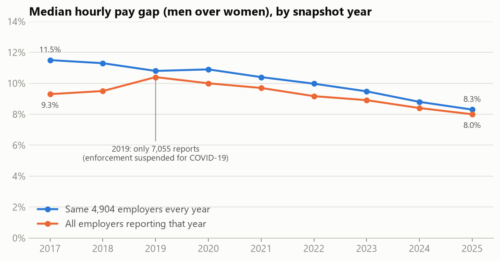
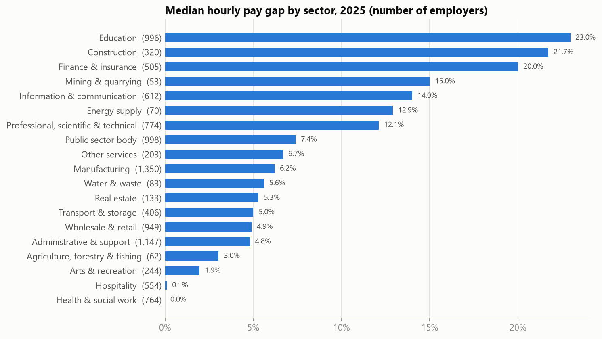
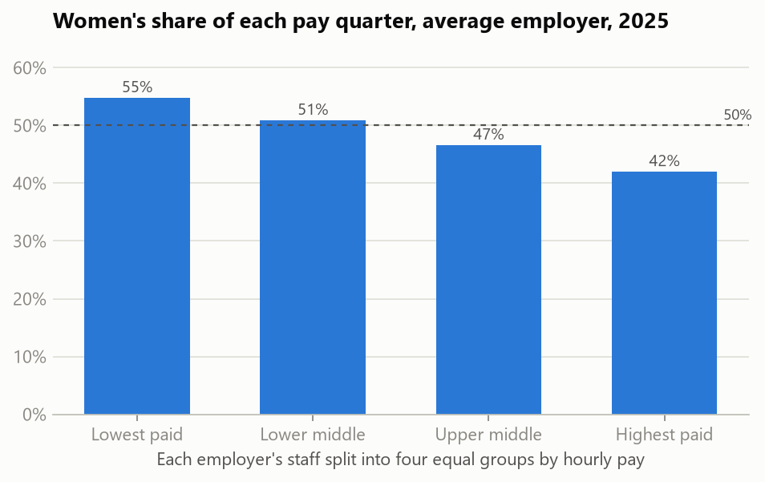
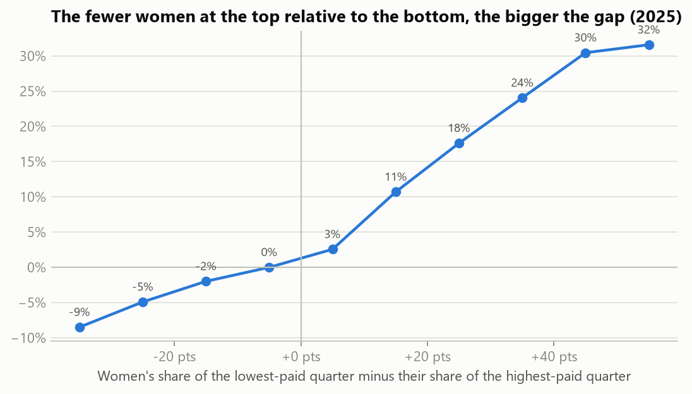

# UK Gender Pay Gap Explorer

**Is the UK gender pay gap closing, where is it widest, and what actually drives it?**

Every UK employer with 250 or more staff must publish its gender pay gap each year. This project combines all **94,206 official reports from 15,725 employers (2017 to 2025)** into one clean dataset. It measures the trend fairly, compares sectors, and tests what explains an employer's gap. It comes with an interactive app where you can look up any employer and compare it with its sector and the UK.

**▶ Interactive app:** *link added after deployment*

## Results

- **The gap is closing slowly.** Among the **4,904 employers that reported in every year**, the median hourly pay gap fell from **11.5% to 8.3%** between 2017 and 2025, and **61%** of them narrowed their gap. Tracking the same employers matters: the all-employer figure starts lower (9.3%) because the mix of reporting employers changes from year to year.
- **But most employers still pay men more.** 77.5% of employers had a gap in men's favour in 2025, almost exactly the same share as in 2017 (77.1%). Gaps got smaller rather than disappearing.
- **The gap is about who holds the top jobs, not how many women an employer has.** In the average employer, women hold **55% of the lowest-paid quarter of jobs but only 42% of the highest-paid quarter.** That difference explains about a third of the variation in gaps between employers: a correlation of **0.59**, against **0.10** for the share of women overall. Each 10-point drop in women's share at the top relative to the bottom goes with a gap about 6 points wider.
- **Sector matters a lot.** Education (23.0%), Construction (21.7%) and Finance & insurance (20.0%) have the widest median gaps, while Health & social work (0.0%) and Hospitality (0.1%) have almost none. Education is a clear example of the "top jobs" effect: women are 81% of the lowest-paid quarter but 67% of the highest.









## What this means for an employer

The data points to the same lever across sectors: **the gap closes when more women move into the highest-paid roles,** not just when more women are hired. An HR team would track women's share of each pay quarter alongside the headline gap, and look at promotion rates and the pipeline into senior roles.

## How it works

1. **Data** ([`gpg/data.py`](gpg/data.py)). Downloads the nine yearly CSVs from the GOV.UK gender pay gap service and stacks them into one table keyed by employer ID and year. **The `ResponsiblePerson` column, which names an individual and often their email, is dropped on load,** along with addresses, so no personal data reaches the repository. A test checks this.
2. **Sector.** Taken from the first industry (SIC 2007) code each employer lists, mapped to its SIC section. The download drops leading zeros (`1470` is `01470`), so codes are padded first. Code `1` marks public bodies that give no code (councils, NHS trusts, universities), labelled "Public sector body". A missing code is filled from the same employer's other years.
3. **Fair trend** ([`gpg/analysis.py`](gpg/analysis.py)). Compares all reporting employers with a **balanced panel** (only employers present in all nine years), so the trend isn't distorted by employers joining or leaving the data.
4. **What explains the gap.** Correlates each employer's median gap with (a) its overall share of women and (b) women's share of the lowest-paid quarter minus their share of the highest-paid quarter.
5. **App** ([`app.py`](app.py)). Streamlit and Plotly: look up an employer's history against its sector and the UK median, see its pay quarters, and compare sectors by year.

## Assumptions and limitations

- **A pay gap is not unequal pay.** It compares the average woman with the average man at an employer, not people doing the same job. It mostly shows who does which jobs.
- Gaps are employer-reported and not audited. Some reports contain implausible values; the analysis uses **medians**, which extreme values affect less.
- **2019 had only 7,055 reports** because enforcement was suspended during COVID-19. The balanced panel is unaffected.
- Sector uses only the first SIC code an employer lists; 31% of employers list more than one.
- Only employers with 250+ staff must report, so small firms are not covered.
- Correlation is not causation: under-representation at the top goes with larger gaps, but this data cannot show why women are under-represented.

## Run it yourself

```bash
python -m venv .venv
.venv\Scripts\activate            # Windows  (macOS/Linux: source .venv/bin/activate)
pip install -r requirements.txt
streamlit run app.py              # the app, using the processed data in data/processed/
python run_analysis.py            # tables and charts
python run_analysis.py --rebuild  # re-download the raw CSVs from GOV.UK and rebuild
pip install pytest && pytest      # 7 tests: SIC mapping, personal data removed, balanced panel, the app runs
```

```
gpg/          data.py (download, tidy, sectors) · analysis.py · figures.py
app.py        Streamlit app
run_analysis.py
data/processed/gpg_reports.csv.gz   all reports, personal data removed
outputs/      figures/ and tables/
tests/
```

## Why I built this

People analytics questions come down to the same skills as any other analysis: combine messy yearly files correctly, compare like with like, and separate what the headline number shows from what is really driving it. I wanted a project on fully public, official UK data where the answer is useful to an HR team, not just interesting.

---
Data: [GOV.UK Gender pay gap service](https://gender-pay-gap.service.gov.uk/), contains public sector information licensed under the [Open Government Licence v3.0](https://www.nationalarchives.gov.uk/doc/open-government-licence/version/3/). Built by [Obaid Ullah Masood Raja](https://www.linkedin.com/in/obaidullah-masood-raja-225795218).
